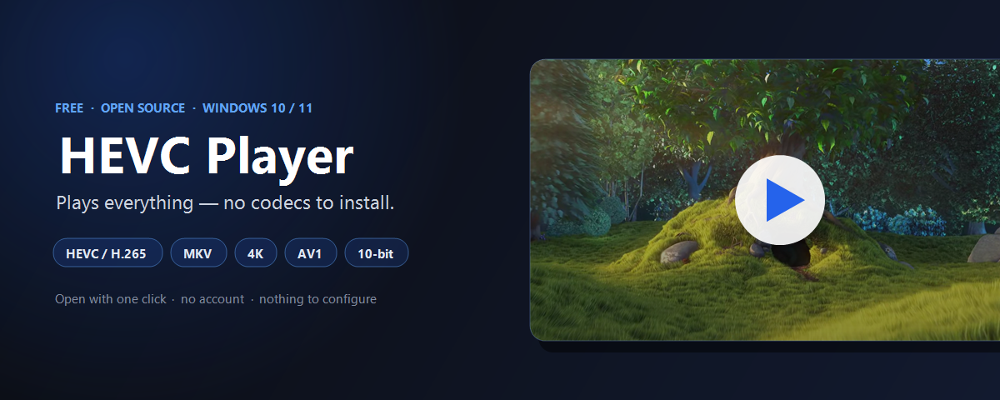
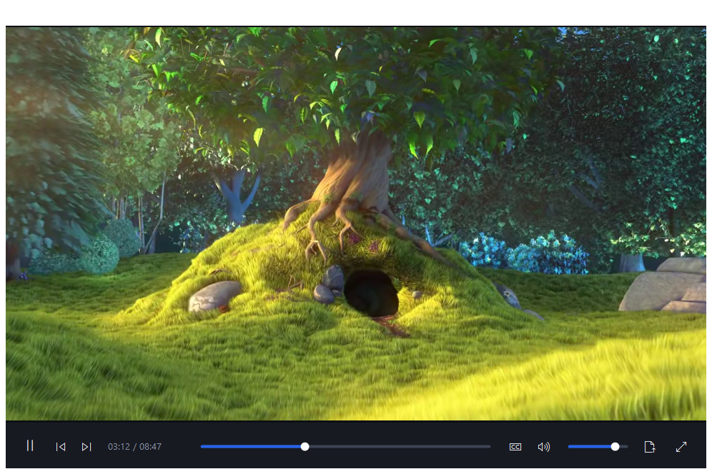
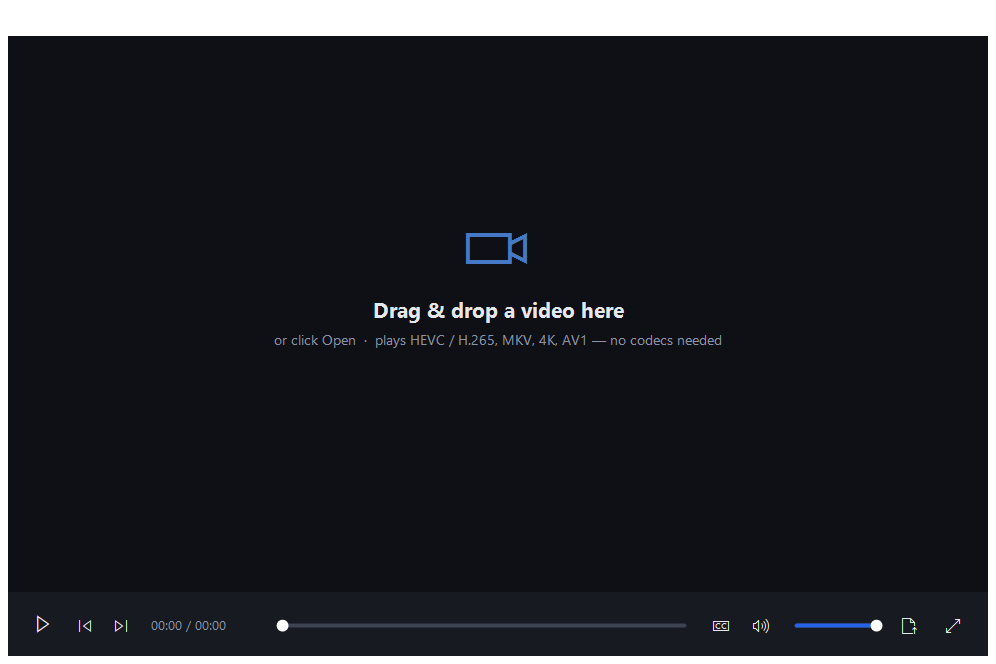

  

<h1 align="center">HEVC Player</h1>

  <b>Play <code>HEVC</code> / <code>H.265</code>, <code>MKV</code>, <code>4K</code> and <code>AV1</code> video — with no codecs to install.</b> 
  A small, free, offline video player for Windows 10 / 11 (64-bit).

  
  
  
  

---

## What it does

A lot of modern video just **won't play** on a clean Windows install: 4K clips from phones, movies in **MKV**, anything encoded with **HEVC / H.265** or **AV1**. You double-click and get a black screen, audio with no picture, or a prompt to **buy** the "HEVC Video Extensions" from the Microsoft Store.

**HEVC Player** fixes that. It carries its own video engine inside the app, so it plays all of those formats **straight out of the box** — nothing to buy, no codec packs to hunt down, no setup.

  

## Features

- 🎞 **Plays everything** — HEVC / H.265, AV1, MKV, MP4, MOV, AVI, WebM, TS, M2TS, FLV and more
- 🖥 **4K · 10-bit · HDR-range** content, with hardware-accelerated decoding
- 🚫 **No codecs, ever** — no codec packs, no Microsoft Store "HEVC Video Extensions" purchase
- 🖱 **Drag & drop** a file — or several, they become a playlist
- 💬 **Subtitle & audio track switching** built in
- 🌑 **Clean dark interface**, fullscreen, and handy keyboard shortcuts
- 🪄 **Self-setup** — on first run it adds a Desktop and Start-Menu shortcut, so you never lose it
- 🔒 **100% offline & private** — no account, no sign-up, nothing is uploaded anywhere
- 🆓 **Free and open source** (MIT)

## How to use

1. Download the latest release and unzip it.
2. Launch **HEVC Player** from the unzipped folder.
3. **Drag a video onto the window** — or click the Open button (bottom-right).
4. Watch. That's it.

  

### Keyboard shortcuts

| Key | Action | | Key | Action |
|-----|--------|---|-----|--------|
| `Space` | Play / pause | | `M` | Mute |
| `F` / double-click | Fullscreen | | `← →` | Seek 5 s |
| `Esc` | Exit fullscreen | | `↑ ↓` | Volume |
| `O` | Open file | | `J` | Switch subtitles |

## Download

➡️ **[Download the latest release](../../releases/latest)** — unzip and launch **HEVC Player**. Windows 10 / 11, 64-bit.

## Built with

HEVC Player is a clean desktop front-end around the excellent open-source **mpv** media engine. The engine is bundled unmodified and used through its public client API (loaded dynamically at runtime):

| Component | Role | License |
|-----------|------|---------|
| [mpv / libmpv](https://mpv.io) | decodes & renders the video | LGPL v2.1+ / GPL v2+ |
| [FFmpeg](https://ffmpeg.org) (inside mpv) | demuxers & decoders | LGPL v2.1+ |

The app itself (its interface and wrapper code) is released under the **MIT License** — see [LICENSE](LICENSE). The bundled engine is upstream and unmodified; its source is available at [mpv.io](https://mpv.io) and [ffmpeg.org](https://ffmpeg.org). Building from source is described in [BUILD.md](BUILD.md).

---

<b>Keywords:</b> hevc player · h265 player · h.265 player · mkv player · 4k video player · av1 player · play hevc on windows · play h265 without codec · codec-free video player · hevc video extensions alternative · free video player · no ads · no account.
